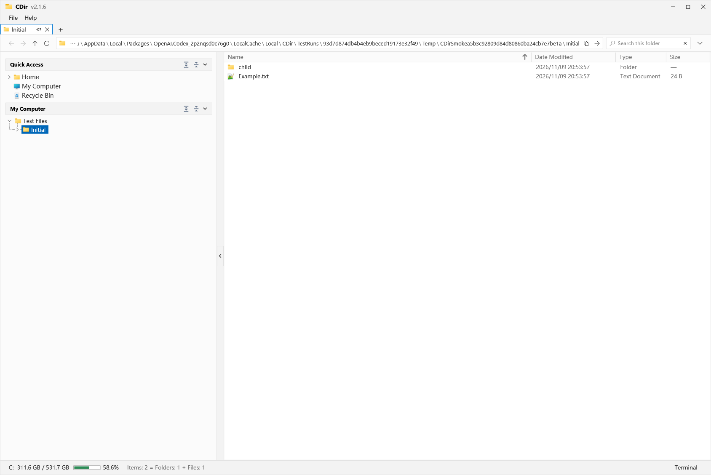

# CDir

## English

### About CDir

CDir is a compact Windows file manager for everyday file browsing, organization, and project navigation. It combines tabs, a directory tree that loads on demand, an editable address bar, and custom bookmark categories in a light interface. Recursive search, Git/SVN status badges, and an embedded PowerShell terminal help you work with local folders and code repositories.

Built with C#, WPF, and .NET 10, CDir supports English, 简体中文, 日本語, and 한국어. It is distributed as a portable application with no account system, telemetry, or update checks.



### Opening CDir

Choose either way to open the latest published version:

1. Extract `Publish/CDir_WinX64_v<major>.<minor>.<patch>.zip`, open the extracted versioned folder, and double-click `CDir.exe`.
2. If you already have the repository's runnable release, open `Publish/CDirWinX64/` and double-click `CDir.exe`.

Keep all files and subfolders in the release together. The package includes the .NET runtime, requires no installer or separate .NET installation, and does not require administrator privileges.

The target platforms are **Windows 10 / Windows 11, 64-bit**. Builds and automated regression checks currently run on Windows 11 x64; Windows 10 still needs validation on an actual installation. Windows 10 compatibility depends on the exact edition and version: the official .NET 10 support list is limited to supported LTSC / Enterprise releases. Windows 10 Home/Pro 22H2 is not on that list. See [Microsoft's installation and support information](https://learn.microsoft.com/en-us/dotnet/core/install/windows) and the [.NET 10 supported operating systems](https://github.com/dotnet/core/blob/main/release-notes/10.0/supported-os.md).

### Features

- Opening CDir.exe runs a verified private copy outside the checkout, so switching Git branches can replace the published program files while existing windows stay open. An open window keeps its starting version; open CDir.exe again to use the selected branch's version.
- Press Alt+R to distribute all panes in the current window as evenly as their minimum sizes allow. Columns share the window width evenly, then rows share the height within each column; split directions, tabs and the active pane stay in place. Customize this shortcut in Keyboard Shortcuts.
- Right-click any file-list header and choose Size All Columns To Fit, or press Alt+E in the current tab. Each displayed column fits the wider of its header and current file/folder values, including off-screen rows. Only that tab changes. Customize, clear, or reset the shortcut in Keyboard Shortcuts.
- Drag a tab to the left, right, top, or bottom edge of a pane’s directory tree or file panel. A translucent preview shows the full workspace area before release. Each pane has its own tab strip, address bar, search, tree, file panel, status bar, and terminal. Split panes again, resize their dividers with live content updates, or move tabs between strips; empty panes merge automatically. Layout and selections restore on restart. Tab shortcuts and bulk-close commands act within the current pane.
- Drag any edge or corner of a restored window to resize it. Quick Access includes My Computer and Recycle Bin, and uses the fixed order Home, Desktop, Documents, Downloads, Pictures, My Computer, Recycle Bin. My Computer opens a drive overview in the current tab. Close Other Tabs preserves every pinned tab and closes only the other unpinned tabs, with one final workspace save for the batch.

- Folder size calculation is off by default. Enable Preferences > General > Calculate Folder Sizes In The Background to show recursive totals in the Size column, including hidden descendants. Unchecking stops calculation and clears folder totals; file sizes remain visible. One throttled background scan runs at a time; changing folders or tabs and hiding Size cancel pending work. `—` means unknown, `≥` marks a partial total, and links are not traversed. Press `F5` to recalculate after changes inside subfolders.
- Expand or collapse Quick Access and the drive tree by clicking their headings; section state is saved. Directories load on demand and selection follows navigation. A single tree-folder click navigates immediately without expanding or waiting for a double-click interval. A double-click also expands or collapses that folder without duplicate loading or history entries. When the main panel gains focus, the tree and matching bookmark category synchronize to its current path. Navigation preserves selection and sidebar scroll position; arrows change expansion independently. Category headings do not connect to bookmark roots. Expanded root folders retain their full subtree indentation guides; child connectors and pinned rows use the actual child-tree guide columns. Right-click a drive or folder in the tree to expand or collapse all subfolders in that branch.
- Drag sidebar category headings to reorder sections, including Quick Access and My Computer. A blue line marks the insertion point and order is saved. Right-click only blank sidebar space to create a category. Category context menus expand or collapse all contained folder branches while keeping the category open. Custom categories can also be renamed or deleted; built-in sections cannot.
- Bookmark folders in Quick Access and custom categories can expand through multiple directory levels. Click a subfolder to open it or drag it to another custom category.
- The address bar displays path segments with hover highlighting. Click a segment to navigate. Click blank space or press `Ctrl+L` / `Alt+D` to type or paste a path; `Enter` navigates and `Esc` cancels. Quoted paths, relative paths, environment variables such as `%USERPROFILE%`, `~`, and UNC shares are supported. A file path opens its containing folder and selects the file.
- Long paths prioritize the current directory. The `…` menu provides access to any ancestor.
- Copy the current path or selected item paths, and navigate back, forward, up, or refresh.
- New folders and F2/single-item Rename use an inline filename editor. Enter confirms, Esc cancels naming, and files initially select their stem without the extension. Copy/move actions show native Windows progress and same-name replacement prompts with cancellation and refresh the destination before reporting completion.
- A detailed file list supports column sorting, multiple selection, and recursive name search through the current directory and subdirectories. Use `/file` for files only or `/dir` for folders only, for example `report /file` or `/dir work`. Hidden items are controlled in Preferences. Counts and operation messages appear in the status bar; the selected-item count is separate from total, folder, and file counts.
- Search supports regular expressions (`/regex` or `/r`, for example `/r ^report.*\.txt$ /f`) and `*` / `?` wildcard patterns such as `report*.txt` or `*report*`. `/wildcard` or `/w` explicitly enables wildcard mode. Matching ignores case by default. Input hints complete mode commands, and invalid or timed-out expressions produce a message.
- Drag any visible header horizontally to reorder columns. File > Preferences > UI controls visibility of Name, Date Modified, Type, Size, and Absolute Path. Order and visibility are saved. Absolute Path appears only in search results, and at least one normal browsing column must remain visible.
- Click a header to toggle ascending or descending sorting. The active header shows a bold arrow: ↑ for ascending and ↓ for descending. Other columns show no arrow.
- The list, tree, Quick Access, and address bar display Windows Shell icons, including associated applications, programs, shortcuts, and custom folder icons.
- Git/SVN badges in the list, tree, and address bar come from actual workspace queries and distinguish unchanged, modified, added, deleted, renamed, conflicted, untracked, and ignored items. Commits and reverts trigger refresh.
- Context menus and shortcuts support new folders, rename, copy, cut, paste, and recycling, with Windows file-clipboard interoperability.
- Files, folders, and blank list space use complete native Windows Shell context menus, corresponding to Show More Options in Windows 11. Windows supplies commands, associations, and third-party extensions; CDir adds no application items. Right-click blank space and choose New to create a folder or a file type registered with the system. Category shortcuts support opening, reordering within a category, and removal. Their entries and order are saved without moving or deleting original folders.
- Drag one or more folders from Windows Explorer, the desktop, another CDir window or tab, or the main panel onto a custom-category heading or blank content area to add shortcuts. Existing entries and files in mixed selections are skipped. Dropping files or folders onto a concrete sidebar folder copies them when the drag-copy preference is checked, or moves them when unchecked. Address-bar, My Computer and Quick Access folder drags support both destinations.
- Dropping files or folders back into their source directory does nothing in both copy and move modes, including when another pane displays that same directory.
- Ctrl+X in the main panel fades the selected files and folders until the cut is pasted, replaced, or canceled with Esc. Refreshing or switching tabs preserves the pending cut state.
- Cut from the native context menu shares the Ctrl+X fading and Esc cancellation behavior. Alt+Q toggles the whole sidebar and can be customized in Keyboard Shortcuts. Ctrl+F focuses search; Esc returns focus to the file list while keeping the query. Quick Access opens the Recycle Bin inside the main panel with its Windows icon and native item operations, including Back, Forward, and Refresh support.
- The embedded terminal uses a native text editor for system IME composition and candidate confirmation. It retains input focus after clicks and supports Chinese, Japanese, Korean, and other text with font fallback.
- Terminal completion predictions and their tooltips use muted gray to distinguish them from entered commands.
- The directory-tree menu places New Folder below Collapse All Subfolders with a separator. Create inside the clicked directory, including category roots and nested folders. The parent expands to show the child while the main-panel location stays unchanged. The new folder appears immediately for inline naming; Enter confirms and Esc keeps its default name. Suggested names skip existing files and folders, and conflicts preserve existing items.
- Folders from My Computer and Quick Access can also be dragged into custom categories. Dragging a category folder entry to another category moves its shortcut out of the source; if the destination already has the folder, it keeps one entry. Dragging within one category reorders it. Original folders stay on disk.
- Drag the address bar's folder icon into a category to add the current directory, or drag a path segment to add that ancestor. The current address, main-panel location and browsing history remain unchanged; duplicate entries are skipped.
- Drag a category folder outside the sidebar and release, including outside the window, to remove its shortcut. Esc cancels and keeps it. Original folders and entries in other categories remain intact.
- The main panel is a flat directory listing: a single click selects a folder and a double-click enters it. Double-click files to use their default application. Open a terminal or Windows Explorer at the current location.
- An embedded PowerShell terminal appears beneath the list. Click Terminal at the lower right or press `Alt+X` to show or hide it. Its first session starts in the displayed directory. Hiding retains the process, working directory, and output. Drag the divider to resize it or restart the session from its title bar. Use the right-side scrollbar to browse output history; dragging, clicking the track, and scrolling the wheel stay synchronized.
- Use `Up` / `Down` in the terminal to browse session command history. Returning to the newest position restores unsubmitted input. Hiding keeps history; restarting clears it.
- Preferences > Terminal Theme controls terminal font size (8–48) and background color, with swatches, custom `#RRGGBB` input, live preview, saving, and updates to existing sessions. Hover over any part of the terminal and use fixed `Ctrl+Wheel` to resize text without changing focus. With terminal focus, use `Ctrl++` or `Ctrl+-`; numeric-keypad plus and minus are supported. Keyboard zoom bindings remain customizable; wheel zoom is fixed. The footer shows these tips beside Background Color.
- Terminal Theme also supports custom text colors or automatic contrast. The terminal footer shows current font size and background color code. `Ctrl+0` restores the default size of 15 and is customizable. Keyboard shortcuts, the native text input, and the context menu share paste behavior.
- Ordinary directory changes refresh automatically. Completed search results remain stable until `F5` refreshes them. Search results add a sortable Absolute Path column, hidden when search is cleared. The last location, window size, and hidden-item preference are saved.
- Drag files and folders from Windows Explorer, other file managers, or other CDir windows onto empty main-panel space or a target folder. Recycle Bin drags retain Shell identities and original names. Windows Recycle Bin offers Move only, so it moves items out even when copying is configured; ordinary sources still follow the copy preference. Dropping back into the source directory does nothing in either copy or move mode. Copy On Drop in General is on by default, so drops copy items and preserve the sources; disable it to move. Existing saved choices are retained. Selected main-panel files and folders can also be dragged out.
- Drop files and folders onto a directory name in the address bar when it highlights to move them there. With Copy On Drop enabled, they are copied instead. The current browsing location stays open.
- Maximization respects the current monitor's work area so the bottom status bar remains visible. Configured shortcuts, including the terminal toggle, are forwarded by the main window.
- A Windows notification-area icon remains visible until CDir exits. By default, closing the window or its last tab (including Ctrl+W) hides it; double-click the icon to restore the same window and tabs. Right-click it to open or exit. Enable Exit CDir On Close in Preferences > General to make Close exit instead; the choice saves immediately.
- Windows sign-in startup is off by default. Enable Start CDir When I Sign In To Windows in Preferences > General to register the current executable for your Windows user; unchecking or restoring defaults removes this copy’s entry. Cut (Ctrl+X) and terminal wheel zoom (Ctrl+wheel) are fixed and omitted from shortcut customization.
- With a single instance, the current workspace is saved automatically about once per second. Multiple instances keep changes private. On exit, confirmation is needed only if another instance saved a different layout or configuration; otherwise the current state is saved automatically. Ctrl+N clones the current window’s full workspace and tree expansion; launching another instance from its icon clones the most recently active window. Preferences and workspace snapshots use flushed atomic writes with a previous-version backup. Startup restores tabs, active folder, tab names, navigation history, search, sorting, selection, column widths, sidebar layout, window bounds, and terminal panel state. After a crash or sudden power loss, recovery uses the latest completed save; terminal panels open fresh PowerShell sessions.
- Horizontal and vertical scrollbars are 12 DIP. Scrollbars use hover/drag visibility where configured. Fixed `Shift+Wheel` horizontally scrolls the area beneath the pointer and is not customizable; the ordinary wheel scrolls vertically.
- The column dropdown ends with Show Hidden Files And Folders, synchronized with Preferences > General. Turning off file-list grid lines also removes separators beneath file rows.
- Preferences > UI > Auto Fit Columns When Opening Folders is unchecked by default. Enable it to fit every displayed column to its header and folder contents whenever a folder opens; background refreshes preserve manual widths.
- Preferences > UI > Show Drive Usage In My Computer is unchecked by default; enable it for capacity text and percentages beside drives, with a usage bar below each drive aligned to the drive content row, excluding the expander gutter and outer padding. Drive root paths are not repeated beside drive names.
- Preferences > UI > Show Folder Paths is off by default. Enable it for absolute paths beside every directory-tree folder, including expanded descendants and pinned parents; hover shows the full path immediately. Folder paths and drive capacity panels share an aligned right-hand column. Pinned parents are limited to expanded branches and category headers yield at the next section.
- Drag pinned or ordinary tabs to reorder their own group. With the separate pinned row visible, drag across rows to pin or unpin at the drop position. The insertion marker shows the destination, row edges scroll during a drag, and both group orders are saved.
- Pin or unpin the current tab with `Alt+W` (customizable in Preferences > Keyboard Shortcuts), or click the pin between its label and Close. Pinned tabs stay on the left in pin order; unpinning moves a tab to the front of the ordinary group. Preferences > UI > Show Pinned Tabs In A Separate Row is off by default and optionally places pinned tabs above the ordinary row. Pin state, order, and the row preference survive restart. Tab Close uses the same red hover and pressed colors as window Close.
- File-list grid lines are off by default, including after restoring UI or all Preferences. Saved explicit choices are retained.
- Restore Default Settings opens a scope chooser: reset only the current Preferences category (selected by default), or all Preferences. Cancel and Escape leave settings unchanged. Category resets preserve settings in the other categories.
- Preferences has General, UI, Terminal Theme, and Keyboard Shortcuts categories. General includes language, 12/24-hour time, hidden items, close behavior, Copy On Drop, background folder-size calculation, and optional Windows sign-in startup (off by default); UI includes panel font sizes, grid lines, folder paths, drive usage, and column visibility; Terminal Theme contains font size, background, and preview controls. English, 简体中文, 日本語, and 한국어 can be switched immediately and are remembered. The path, filter, sorting, and selection are preserved.
- The light theme uses three gray-white layers: outer `#F3F3F3`, middle `#FBFBFB`, and inner `#FFFFFF`, with `#F3F3F3` focus hints. The main window, menus, dialogs, and Preferences share the palette; the terminal has its own theme.

### Keyboard Shortcuts

In File > Preferences > Keyboard Shortcuts, search customizable shortcuts by action name or key combination. Rows are sorted by English action name. Fixed actions such as New Window, Copy, Cut, Paste, and terminal wheel zoom are omitted. Select an editor and press a new combination to apply and save it immediately. Each item supports Clear and Reset; duplicate combinations produce a conflict message. Menus, tooltips, and help reflect current bindings. Defaults include:

| Shortcut | Action |
| --- | --- |
| `Ctrl+L` / `Alt+D` | Edit the address bar; press `Enter` after pasting to navigate |
| `Ctrl+Shift+C` | Copy current folder path |
| `Alt+Left` / `Alt+Right` / `Alt+Up` | Back / forward / parent directory |
| `Alt+X` | Show or hide embedded terminal |
| `Ctrl+F` | Search current folder and subfolders |
| `F5` | Refresh directory and icons |
| `Ctrl+Shift+N` | New folder |
| `Ctrl+C` / `Ctrl+X` / `Ctrl+V` | Copy / cut / paste |
| `Ctrl+A` | Focus the main file panel and select every visible item |
| `Enter` / `F2` / `Delete` | Open / rename / move to Recycle Bin |

In the main window, outside inline filename editing, Ctrl+A moves focus from search, address, sidebar, tabs, or terminal to the file panel and selects every visible result without clearing the search filter. Preferences and other dialogs remain open and keep normal text selection. Other text-editing shortcuts, including copy, cut, and paste, retain their text-field behavior. Mouse side buttons navigate Back/Forward in the active tab; mouse-driver browser commands and dedicated browser keys are also supported.

### System Icons

Windows Shell supplies icons for actual files and directories. A generic icon is used when extensions cannot supply one, a location is inaccessible, or reading times out. Press `F5` after changing file associations or folder icons. Icons are cached only in memory; CDir does not save extracted icons to disk.

Shortcut arrows are preserved. Version-control badges are drawn separately from workspace queries rather than reusing third-party Shell overlay caches.

List icons are 16 DIP. Default rows are 22 DIP high and grow with larger fonts. Grid lines use a separate drawing layer; turning them off removes row separators without changing row borders or content insets. Tree and Quick Access spacing remain compact; empty states use larger system folder icons. The application, window, and title bar use the standard Windows yellow folder icon. `Source/Resource/App.ico` contains nine sizes from 16 to 256 pixels and can be regenerated from the current Windows installation using `Source/Scripts/UpdateAppIcon.ps1`. Address-copy, navigation, and refresh buttons use glyphs.

Before creating a window, CDir sets the fixed taskbar application ID `CDir.FileManager` so Windows groups its windows under CDir.

When scrolling a long sidebar tree, the owning category and every parent of the visible tree branch stay pinned at the top, independently of the main panel's directory. Pinned folders retain the original tree's measured indentation, expand/collapse arrows, icons, and dotted guide columns, aligned with the scrolling tree below. Their context menus can collapse the entire category or folder branch without scrolling back. Folders and categories expand and collapse with a brief 130 ms transition, respecting Windows reduced-motion settings. Files opened from the panel, including .bat/.cmd scripts in recursive search results, use the displayed panel directory as their working directory.

### Git / SVN Workspace Status

CDir detects Git or SVN workspaces by walking up from the current directory. Nested workspaces use the nearest repository; ordinary folders have no badges. Install Git command-line tools 2.31+ or SVN command-line tools 1.8+. CDir searches `PATH`, installation registry entries, and standard directories for `git.exe` / `svn.exe`, including TortoiseSVN installed on other drives. Locally validated versions are Git 2.55.0.windows.5 and SVN 1.14.5. Missing tools, insufficient permissions, timeouts, or incomplete output produce a gray question mark and a reason rather than being treated as unchanged.

Git uses `status --porcelain=v1 -z` and tracked-file lists, covering the index, working tree, renames, submodules, nested repositories, and worktrees. SVN uses local `info --xml` and `status --xml --verbose --no-ignore --depth=immediates` queries for files and immediate children of visible directories, checking content, properties, and conflicts. A separate non-verbose recursive status query aggregates changes from unopened subtrees without outputting every clean descendant. Entering or expanding a directory adds its clean-file inventory as needed. Operations are local and read-only: no commit, update, revert, or remote query is performed.

| Badge | Meaning |
| --- | --- |
| Green `✓` | Tracked and unchanged |
| Red `!` / `×` | Modified / conflicted |
| Green `+`, red `−`, blue `↗` | Added, deleted, renamed |
| Blue `?`, gray `−` | Untracked, ignored |
| Gray `...` | Verification in progress |
| Gray `?` | Status unavailable; hover for the reason |

Files show their own status. Modifying one file does not mark unchanged siblings red. Repository folders summarize children and tooltips explain contained changes, so a folder can have a badge without being edited itself. SVN summaries include recursive local changes in unopened subtrees, while clean-file inventories are limited to visible directories. Ignored items do not dirty parent folders. Git does not track empty directories, so empty untracked folders have no badge. Ancestors outside a repository do not aggregate changes across repository boundaries. Visible nested repositories are queried independently. SVN externals are verified through their own workspaces; unverified externals are not marked clean.

The current folder is queried before sidebar repositories; each completed repository publishes its badges immediately. SVN batches visible inventories and verifies each working-copy root once, displays file badges first, and prioritizes recursive summaries for the current subtree before wider sidebar work. Unverified ranges remain pending. Git groups untracked directories instead of outputting every untracked descendant.

The initial repository visit queries status and establishes watchers. Further queries follow file creation, modification, deletion, or renaming and relevant metadata changes such as Git index/HEAD/refs. There is no periodic polling or repeated query merely on window activation. Navigation and tree scrolling within one repository reuse verified snapshots. Unrelated lock-file, object-store, and log changes do not trigger rescans. Bursts are combined over roughly 100 ms, obsolete results are discarded, and navigation or changes in the current folder can cancel lower-priority sidebar work. Unchanged tracked-file lists and clean-directory summaries are reused. `F5` forces refresh; refresh manually if watching is unavailable. Repository discovery and merged SVN views are cached. Timestamp-only metadata changes, SVN administrative temporary files, and read-only Git/SVN commands keep verified badges stable; background checks update only badges whose verified state changes. Pending dots are reserved for the first unverified visit.

### File Operation Boundaries

- Search matches file and folder names recursively under the current directory and supports `/file` (`/f`) and `/dir` (`/d`) type filters. Focusing an empty search box shows all hints; typing `/` narrows them, and clicking completes a command. Clearing search restores the directory listing. Search respects hidden-item settings, skips inaccessible directories, and does not follow directory links or junctions.
- Copy and move use native Windows confirmation and progress dialogs for replacement, skipping, cancellation, and folder merges. Symbolic links and junctions remain excluded.
- Batch operations may finish partially; completed items remain after failure or cancellation. Cross-volume moves still need validation on actual systems.
- Delete uses the Windows Recycle Bin with system confirmation. Recycling from network or removable drives is rejected. If Windows says recycling is unavailable, review the dialog before deciding whether to continue.
- Network shares and Windows 10 still require corresponding real-system validation. Restricted, offline, or nonexistent locations display an error and preserve the current directory.
- CDir does not replace the Windows default file manager or browse archives. Drag and drop, tabs, and recursive search are supported.

CDir has no account system, telemetry, or update checks. Network behavior of shares, Shell extensions, and external programs is controlled by those components.

Settings are stored in `%LOCALAPPDATA%\CDir\Settings.json`, including the interface language. First launch migrates old DocReader settings while preserving language, custom categories, and sidebar order. Existing CDir settings take precedence; the old file is retained. First use defaults to English, as do older settings without a language field. The bundled preferences in `Source/Config/DefaultSettings.json` exclude personal categories, folder paths, and navigation state; new users start with no custom categories. Use Restore Default Settings in Preferences to reset preference choices. Workspace recovery is stored separately in `Settings.json.workspace.json`; settings and workspace files also have `.bak` backups, so deleting only `Settings.json` does not fully reset saved state.

Preferences > UI > Panel Font Sizes independently adjusts File List, Column Headers, Sidebar, Address And Search Bars, Menus, Status Bar, Title Bar, and Preferences (8–24). Changes apply and save immediately; input heights follow font sizes.

### Building From Source

Windows x64 and the .NET 10 SDK are required. Run in the project directory:

```powershell
.\Source\Scripts\Build.ps1
```

By default, the script only builds. It does not run tests, launch or restart CDir, publish, or package. Build and test processes use background I/O scheduling. CPU usage is uncapped and affinity is unrestricted by default. For distribution, use:

```powershell
.\Source\Scripts\Build.ps1 -Publish
.\Source\Scripts\Build.ps1 -Package
```

Both `-Publish` and `-Package` publish and create a ZIP. Steps run serially and do not run tests automatically. Run the relevant test groups before publishing. If this workspace’s published executable is running, the script verifies its path, captures complete live workspaces and settings backups, stops those instances, restores the most recently active snapshot, and reopens the application once after success. A failed capture stops publication before any instance is terminated; a failed publication does not launch the partially updated application. First publication may download Microsoft .NET runtime packages. Outputs are:

```text
Publish/CDirWinX64/CDir.exe
Publish/CDir_WinX64_v<major>.<minor>.<patch>.zip
Artifacts/CDir_WinX64_v<major>.<minor>.<patch>.zip
```

The title bar shows `vmajor.minor.patch` next to CDir, starting with a `v0.0.0` baseline. `Source/Version.props` supplies the version consistently to the title, assembly, and packaged `Release.json`. Changes under `Source` increase patch on the next successful release. Repackaging unchanged source, building only, testing, or failed publication consumes no version number. Version state is committed only after build, publication, and ZIP creation succeed, with protection against concurrent releases or source changes during publication.

Major is controlled manually and changes only on explicit user instruction, by editing the first component of `<Version>` or using `-MajorVersion`; it can be raised or lowered and never advances automatically. Changing major resets minor and patch to 0, so that release is exactly major.0.0; this takes precedence over automatic increments and other release flags. Use `-FatalBugFix` for actual fatal crashes, hangs, or interference with other applications; it increases minor after success. Temporary browsing-window unavailability during a file operation alone does not qualify. Use `-FeatureRelease` only when the user explicitly requests a minor increase for a major new feature. Ordinary features, fixes, and UI edits leave minor unchanged.

Patch is fully automatic and increases only after changed source/configuration is successfully released. Raising minor neither resets patch nor changes major; combining fatal-fix and feature flags increases minor only once. For example, an ordinary change after `v0.0.5` releases as `v0.0.6`; a fatal fix or explicitly requested feature release becomes `v0.1.6`. Tests and publication must use the same candidate-version flags.

```powershell
.\Source\Scripts\Test.ps1 -UIGroup language -PublishConfiguration -MajorVersion 1
.\Source\Scripts\Build.ps1 -Publish -MajorVersion 1
# Only for a severe fatal bug; use matching test and publication options.
.\Source\Scripts\Test.ps1 -UIGroup navigation -PublishConfiguration -FatalBugFix
.\Source\Scripts\Build.ps1 -Publish -FatalBugFix
# Only when the user explicitly requests a minor increase for a major feature.
.\Source\Scripts\Test.ps1 -UIGroup fonts -PublishConfiguration -FeatureRelease
.\Source\Scripts\Build.ps1 -Publish -FeatureRelease
# Check version increments, failure protection, and title-bar layout without committing a version.
.\Source\Scripts\Test.ps1 -ScriptGroup release -UIGroup fonts -PublishConfiguration
```

The title-bar icon is 16 pixels, and the title/version default to the sidebar's 13-point font. Upgrading older settings aligns title size with the prior sidebar size; afterwards it can be adjusted independently in Preferences.

For debugging or selected tests:

```powershell
.\Source\Scripts\Build.ps1 -Configuration Debug
& .\Build\Bin\CDir\Debug\net10.0-windows\CDir.exe
# Or launch the built application at a specified folder.
& .\Build\Bin\CDir\Debug\net10.0-windows\CDir.exe "C:\Users"
.\Source\Scripts\Test.ps1 -Group address
.\Source\Scripts\Test.ps1 -Group filesystem
.\Source\Scripts\Test.ps1 -UIGroup navigation
```

Validation results depend on the selected groups and source revision. Routine work runs only groups relevant to the current change; see [UpdateLog.md](UpdateLog.md) for release-specific results. Default background groups are filesystem, language, and address. Git/SVN fixture groups require explicit selection. UI checks run only with `-UIGroup`, on the current Windows desktop with software rendering and owned directories; test windows, menus, and dialogs may be visible. Separate-desktop testing has been removed. Tests do not scan user directories or close applications in use. Reports identify executed, unselected, and skipped groups and elapsed time. See [Source/Tests/README.md](Source/Tests/README.md).

Select UI groups through the runner to retain timeouts and process-tree cleanup:

```powershell
.\Source\Scripts\Test.ps1 -UIGroup address
# File operations and dialogs can be checked separately.
.\Source\Scripts\Test.ps1 -UIGroup operations
# Combine related groups so each project builds only once.
.\Source\Scripts\Test.ps1 -Group address -UIGroup navigation,address
```

Reports and screenshots go to `Artifacts/TestRuns/<run-id>/`. Temporary data stays under `%LOCALAPPDATA%/CDir/TestRuns/<run-id>/` and is cleaned after success using ownership markers. `-SkipBuild` is available when source/configuration is unchanged and the selected binaries have already been built. Use `-Group all` or `-UIGroup all` only when full regression is explicitly needed.

Owned directory names, code files, and custom identifiers use PascalCase. Source is under `Source`; artwork is under `Source/Resource`. External fixed names retain their spelling, including `.editorconfig`, MSBuild/IDE keys, framework APIs, SDK-generated `net10.0-windows` / `win-x64` directories, and .NET culture directories.

After each successful publication and ZIP creation, insert the newest release immediately below the heading, including its version, publication timestamp to the second with timezone, and specific changes to [UpdateLog.md](UpdateLog.md) in the project root. The Chinese guide is [Docs/使用说明.txt](Docs/使用说明.txt); the English guide is [Docs/UserGuide.txt](Docs/UserGuide.txt). Both ship with the release.

After updating the release preview, copy `Artifacts/CDirPreview.png` to `Docs/Images/CDirPreview.png` and update both preview version labels in this README. The documentation copy is included in Git so GitHub can display the image while `Artifacts/` remains ignored.

### Project Structure

- `Source/App.xaml` / `Source/App.xaml.cs`: entry point and startup logic. `Source/CDir.csproj` and `Source/Directory.Build.props` define the project and output paths.
- `Source/UI/MainWindow/`: main window and independent ExplorerTab pages, including browsing, navigation, sidebar, address bar, search, and version-control UI, in the `CDir.UI` namespace.
- `Source/UI/Dialogs/`: name input, category deletion confirmation, and other dialogs.
- `Source/UI/Preferences/`: Preferences window.
- `Source/UI/Themes/`: shared styles and themes; `App.xaml` merges the style dictionaries.
- `Source/Models/`: directory nodes, bookmarks, categories, settings, file metadata, and related models.
- `Source/Services/`: filesystem, Git/SVN, and system-icon services.
- `Source/Controls/`: reusable controls and drawing code, including system icons, list grid lines, and tree guides.
- `Source/Localization/`: four-language resources and language service. Functional English captions use Title Case; explanations, tooltips, and status messages use sentence case. Brands, shortcuts, and user names retain their spelling.
- `Source/Tests/CDirTests.csproj`, `Source/Tests/Program.cs`: isolated filesystem regression tests.
- `Source/Tests/VersionControlTests.cs`, `Source/Tests/VersionControlSmokeTests.cs`: real Git/SVN workspace and UI regressions.
- `Source/Resource/App.ico`: application icon. `Source/Config/`: application manifest and default configuration.
- `Source/Scripts/Build.ps1`, `Test.ps1`, `QuietTools.ps1`, `Package.ps1`: build, grouped tests, and background packaging entry points.
- `Source/Tests/QuietRunner/`: background I/O scheduling, serial queue, and process-tree cleanup. `AGENTS.md` defines efficient current-desktop validation requirements.
- `Source/Directory.Build.props`: application and regression-test output paths.
- `Docs/`: user documentation. `Docs/Images/CDirPreview.png`: README preview included in Git. `Publish/CDirWinX64/`: runnable release.
- `Build/Bin/<project>/`, `Build/Obj/<project>/`: build outputs and regenerable intermediate caches.
- `Build/PublicationWorkspaces/`: preserved live workspaces and settings backups used during publication.
- `Trash/`: archived superseded packages, previews, and diagnostics, retaining their original relative paths. `Publish/` keeps the current runnable release, latest versioned ZIP, and historical versioned ZIPs until explicitly requested cleanup.
- `Artifacts/CDir_WinX64_v<major>.<minor>.<patch>.zip`, `Artifacts/CDirPreview.png`: distribution archive and interface preview.

## 中文

### 软件介绍

CDir 是一款简洁的 Windows 文件管理器，用于日常文件浏览、整理和项目目录导航。它在浅色界面中提供多标签页、按需加载的目录树、可编辑地址栏和自定义收藏分类，并结合递归搜索、Git/SVN 状态徽标和内嵌 PowerShell 终端，方便管理本地文件夹和代码仓库。

CDir 使用 C#、WPF 和 .NET 10 构建，支持 English、简体中文、日本語和한국어，以便携应用形式分发，没有账号系统、遥测或更新检查。


### 打开 CDir

可通过以下任一方式打开最新发布版本：

1. 解压 `Publish/CDir_WinX64_v<major>.<minor>.<patch>.zip`，打开解压后的版本目录，双击 `CDir.exe`。
2. 如果已有仓库中的可运行发布目录，打开 `Publish/CDirWinX64/`，双击 `CDir.exe`。

请保留发布目录中的全部文件和子文件夹。发布包自带 .NET 运行时，无需安装程序或另外安装 .NET，也不需要管理员权限。

设计目标为 **Windows 10 / Windows 11 64 位**。当前构建与自动回归验证环境为 Windows 11 x64，Windows 10 尚需实机验收。Windows 10 兼容性取决于具体版本和版本类型：.NET 10 的 Windows 10 官方支持清单限于仍在支持期的 LTSC / Enterprise 版本，不包含 Windows 10 Home/Pro 22H2，详见 [Microsoft 支持说明](https://learn.microsoft.com/en-us/dotnet/core/install/windows) 和 [.NET 10 系统清单](https://github.com/dotnet/core/blob/main/release-notes/10.0/supported-os.md)。

### 已有功能

- 启动 CDir.exe 时会从仓库外经过校验的独立副本运行，窗口保持打开时也可切换 Git 分支并替换发布目录中的程序文件。已打开窗口保留启动时版本；重新打开 CDir.exe 使用当前分支版本。
- Alt+R 尽可能均匀分布当前窗口内的所有分割窗格，先按列均分宽度，再按每列的行数均分高度，兼容更多列、更多行及连续嵌套分割，并遵守最小尺寸，保留分割方向、Tab 和活动窗格。快捷键可在 Keyboard Shortcuts 自定义。
- 右键任一文件列表表头，选择“调整所有列宽至合适大小”，或在当前 Tab 按 Alt+E，一次调整所有显示列；每列取表头和当前列表内容（含屏幕外项目）的最大宽度，仅影响当前 Tab。可在 Keyboard Shortcuts 修改、清除或恢复快捷键。
- 将文件或文件夹拖回原目录时不执行任何操作，复制和移动模式均适用；另一个窗格显示同一目录时也不会生成副本。
- 将 Tab 拖到窗格目录树或主面板的左、右、上、下边缘，半透明预览会显示松开后的完整工作区范围。每个窗格独立拥有 Tab 栏、地址栏、搜索框、目录树、主面板、状态栏和终端；支持继续嵌套分割、拖动分隔条实时调整两侧完整内容、跨窗格移动 Tab，空窗格自动合并。重启恢复布局与选中 Tab；标签快捷键和批量关闭仅作用于当前窗格。
- 普通窗口支持拖动四边或四角调整大小。Quick Access 加入“我的电脑”，入口固定依次为 Home、Desktop、Documents、Downloads、Pictures、My Computer、Recycle Bin；“我的电脑”在当前标签显示磁盘列表。“关闭其他标签页”保留所有置顶标签，只关闭其他未置顶标签，整批结束后仅保存一次最终工作区。

- 置顶标签和普通标签均可在各自分组中拖拽排序。置顶标签单独一行且已显示时，跨行拖拽可切换置顶状态，并按释放位置插入；拖拽时显示插入标记，行边缘支持自动横向滚动，排序会保存。
- 文件列表网格线默认关闭，重置 UI 或全部偏好设置后也保持关闭；已保存的明确选择继续保留。
- “恢复默认设置”先弹出范围选择：默认只重置当前 Preferences 分类，也可选择全部偏好设置；取消或按 Escape 不作更改。单独重置分类时保留其他分类的设置。
- 用 `Alt+W` 置顶或取消置顶当前标签页（可在 Preferences > Keyboard Shortcuts 自定义），或点击名称与关闭按钮之间的图钉。置顶标签按置顶顺序排列在左侧，取消置顶后进入普通标签最左侧。Preferences > UI 的“在单独一行显示置顶标签页”默认不勾选，开启后将置顶标签放在普通标签上方；置顶状态、顺序和布局选项重启后保留。标签关闭按钮的悬停和按下颜色与窗口关闭按钮一致。
- 列显示下拉菜单末尾的“显示隐藏文件/文件夹”与 Preferences → General 同步；关闭文件列表网格线时，文件条目下方的分割线也会隐藏。
- Preferences → UI → “打开文件夹时自动适配列宽”默认关闭；开启后每次打开文件夹会根据表头和文件夹内容调整全部显示列，后台刷新保留手动列宽。
- Preferences → UI → 显示“我的电脑”中的磁盘用量默认不勾选，开启后在右侧显示磁盘容量和百分比，在每个磁盘下方显示与上方盘符内容行左右对齐的用量条（避开展开箭头和外侧留白）；关闭时两者一起隐藏。磁盘名称旁不再重复根路径。
- Preferences → UI → 显示文件夹路径默认关闭；启用后在所有目录树文件夹（包括展开的子目录和置顶父目录）名称右侧显示绝对路径，悬停立即显示完整路径。路径与磁盘容量面板使用对齐的右侧列。父级置顶仅保留展开分支，分类标题在下一分类进入时退让。
- 文件夹大小默认不计算。在“偏好设置 → General → 在后台计算文件夹大小”中勾选后，Size 列逐步显示包含隐藏文件在内的递归合计大小；取消勾选立即停止计算并清空文件夹合计，文件自身大小始终显示。统计任务串行、分批执行；切换目录或标签、隐藏 Size 列时取消未完成的统计。`—` 表示未知，`≥` 表示仅统计了部分内容；不会递归进入链接或联接目录。子目录内容变化后可按 `F5` 重新计算。
- 左侧常用位置与驱动器目录树可分别点击标题展开、收起，并记住状态；目录按需加载，导航时同步所选位置。单击目录树中的文件夹立即导航，不展开，也不等待双击判定；双击同时展开或收起，同一目录不重复加载或增加历史记录。主面板获得焦点时，目录树及匹配的收藏分类同步回主面板当前路径。跳转时保留选中状态与侧栏滚动位置；箭头独立展开或收起。类别标题与收藏根目录之间不连线，展开后的根文件夹保留完整缩进线；连接子目录的短线及固定目录栏按实际子树坐标对齐。右键点击目录树中的盘符或文件夹，可展开或收起所有子文件夹，递归操作当前分支。
- 拖动左侧类别标题可调整顺序，包括常用位置与目录树；蓝色提示线表示插入位置，顺序自动保存。仅在侧栏空白处右键可新增类别；类别标题右键可展开或收起其下所有文件夹分支，类别本身保持展开。自定义类别还支持重命名和删除。常用位置与目录树为内置分组，不允许删除或重命名。
- 常用位置和自定义类别中的收藏文件夹可逐级展开子目录，点击子目录即可打开，也支持将子目录拖到其他自定义类别。
- 地址栏按级显示路径，悬停高亮文件夹，点击直接跳转到对应目录；点击空白处或按 `Ctrl + L` / `Alt + D` 可输入、粘贴路径，`Enter` 跳转、`Esc` 取消编辑。支持带引号的路径、相对路径、`%USERPROFILE%` 等环境变量、`~` 和 UNC 共享路径；输入文件路径会打开其所在目录并选中文件。
- 路径过长时优先显示当前目录，左侧 `…` 菜单可选择任意级目录。
- 一键复制当前路径、复制选中项目路径，支持后退、前进、上一级与刷新。
- 文件详细列表、列排序、多选、按名称递归搜索当前目录及子目录；使用 `/file` 仅显示文件、`/dir` 仅显示文件夹，例如 `report /file`、`/dir work`。隐藏项目在偏好设置中控制，项目数量和操作提示显示在底部状态栏；已选择数量独立显示，保留总数、文件夹数和文件数。
- 搜索支持正则匹配（`/regex` 或 `/r`，例如 `/r ^report.*\.txt$ /f`）和 `*`、`?` 通配符模糊匹配（例如 `report*.txt`、`*report*`）；也可用 `/wildcard` 或 `/w` 显式启用。匹配默认不区分大小写，输入提示可补全模式命令，表达式错误或耗时过长会显示提示。
- 左右拖动任意可见表头可调整列的显示顺序；“文件 → 偏好设置 → UI”提供名称、修改日期、类型、大小、绝对路径的显示开关，列顺序和显示选择自动保存。绝对路径仍只在搜索结果中显示，普通浏览至少保留一列。
- 点击表头可切换该列的升序、降序；当前排序列表头右侧显示加粗箭头，↑ 表示升序、↓ 表示降序，其他列不显示箭头。
- 文件列表、目录树、常用位置和地址栏显示 Windows Shell 系统图标，包含默认关联程序、应用程序、快捷方式及自定义文件夹图标。
- 文件列表、目录树和地址栏显示由 Git/SVN 实际工作区查询生成的状态徽标，区分未修改、修改、新增、删除、重命名、冲突、未跟踪与忽略；提交和还原后自动刷新。
- 通过右键菜单或快捷键新建文件夹、重命名、复制、剪切、粘贴、移到回收站；与 Windows 文件剪贴板互通。
- 文件列表的文件、文件夹及空白处使用 Windows Shell 原生完整右键菜单（Windows 11 中对应“显示更多选项”），由系统提供命令、文件关联和第三方扩展，不附加 CDir 菜单项；空白处右键的“新建”可创建文件夹或系统已注册的文件类型。类别中的快捷入口支持点击打开、同类别内拖动排序及移除，内容和顺序自动保存，不移动或删除原文件夹。
- 可从资源管理器、桌面、其他 CDir 窗口或标签页，以及主面板拖动文件夹到左侧自定义类别的标题或类别内空白处，添加快捷入口；支持多选，跳过已有条目及混合选择中的文件。将文件或文件夹拖到侧栏具体文件夹时，勾选“拖动时复制文件/文件夹”则复制，未勾选则移动；地址栏、My Computer 和 Quick Access 中拖出的文件夹也支持这两种目标。
- 主面板按 Ctrl+X 剪切后，选中文件和文件夹淡化显示；按 Esc 取消剪切并恢复显示。刷新或切换标签页保留待剪切状态，复制新内容或完成剪切粘贴后自动恢复显示。
- 右键菜单的“剪切”与 Ctrl+X 使用相同的淡化及 Esc 取消行为。Alt+Q 显示或隐藏整个左侧目录栏，可在 Keyboard Shortcuts 中自定义；Ctrl+F 聚焦搜索框后，Esc 退出焦点并保留搜索内容。Quick Access 的回收站在主面板内浏览，使用 Windows 默认图标和原生项目操作，支持前进、后退和刷新。
- 内嵌终端使用系统输入法的文本输入控件处理组词和候选确认；点击后保持输入焦点，支持中文、日文、韩文等文本，并使用相应字体回退显示。
- 终端自动补全建议及其帮助提示使用柔和灰色，便于和已输入命令区分。
- 目录树右键菜单在收起所有子文件夹下方以分割线隔开“新建文件夹”，可在右键点中的目录下创建子文件夹，类别根目录及子目录同样支持。创建后展开父目录显示新项目，主面板保持当前浏览位置；默认名称避开已有文件或文件夹，取消和重名不会替换原项目。
- 新建文件夹后直接在项目位置编辑名称，F2 和单项右键重命名也使用行内编辑；Enter 确认、Esc 取消命名并保留原名，新建文件夹保留默认名称。复制和移动显示可取消的 Windows 系统进度窗口，完成前更新目标列表；多选复制与跨标签页拖拽同步更新源、目标面板。
- “My Computer”和“Quick Access”中的文件夹也支持拖到自定义类别；将类别内的文件夹条目拖到另一类别会移除来源入口，目标已存在该目录时保留一份，同类别内拖动仍用于排序，磁盘上的文件夹保持不变。
- 将地址栏左侧文件夹图标拖到类别中可添加当前目录，也可拖动路径中的文件夹名添加对应的上级目录。拖放后地址、主面板位置和浏览历史保持不变，同类别内不会重复添加。
- 将类别内的文件夹拖到左侧栏以外并松开，即可从原类别移除快捷入口，支持在窗口外松开；按 Esc 取消会保留入口，不影响原文件夹或其他类别中的入口。
- 主面板以平铺列表显示当前目录，单击文件夹仅选中，双击进入文件夹；双击文件使用系统默认程序打开。支持在当前目录打开终端或系统资源管理器。
- 文件列表下方提供内嵌 PowerShell 终端；点击右下角状态栏的 Terminal 按钮或按 `Alt + X` 显示/隐藏，首次打开使用当前显示的目录。隐藏后保留进程、工作目录和输出，可拖动分隔条调整高度，终端标题栏支持重启会话。右侧滚动条支持浏览历史输出，拖动滑块、点击轨道翻页与鼠标滚轮保持同步。
- 内嵌终端支持用 `↑` / `↓` 浏览当前会话的命令历史，回到最新位置时恢复未提交的输入；隐藏后保留历史，重启后清空。
- “偏好设置 → Terminal Theme”可调整终端字号（8–48）和背景颜色，支持色块、自定义 `#RRGGBB` 和实时预览，自动保存并应用到现有会话。鼠标悬停在终端范围内即可用固定的 `Ctrl` + 滚轮调整字号，无需聚焦；聚焦后也可用 `Ctrl++` / `Ctrl+-`，支持数字键盘加减键。键盘缩放绑定仍可自定义，滚轮缩放不可改绑或清除；底栏 Background Color 右侧显示操作提示。
- Terminal Theme 还支持自定义字体颜色或自动配色；终端底栏实时显示字号和背景颜色代码。终端聚焦时用 `Ctrl+0` 恢复默认字号 15，可在快捷键面板修改此绑定；支持键盘、原生文本输入框和右键菜单的统一粘贴。
- 普通浏览时当前目录变动自动刷新；搜索结果完成后保持稳定，按 `F5` 手动刷新。搜索结果额外显示绝对路径列，支持排序，清空搜索后隐藏。记住最后位置、窗口大小与隐藏项目设置。
- 支持从 Windows 回收站或 CDir 回收站视图拖出文件/文件夹并保留原名；Windows 自带回收站只允许移出，复制选项开启时也按移动处理，普通来源仍遵守复制选项。支持从资源管理器、其他文件管理器或其他 CDir 窗口拖入文件、文件夹，放到主面板空白处存入当前目录，放到文件夹行存入该文件夹；同目录拖放不执行复制或移动，也不生成副本。General 中的拖放复制默认开启，拖放时复制并保留源文件，取消勾选后执行移动。已保存的个人选择会保留。支持拖出主面板选中的文件和文件夹。
- 可将文件和文件夹拖到地址栏中的某一级目录名称上，目标目录高亮后松开即可移入；勾选拖放复制时则复制到该目录，当前浏览位置保持不变。
- 窗口最大化使用当前显示器工作区，保证底部状态栏可见；统一转发已配置快捷键，包括 Alt + X 显示/隐藏终端。
- CDir 启动后持续显示 Windows 通知区域图标，直到退出进程；默认点击窗口关闭按钮或关闭最后一个标签（包括 Ctrl+W）时隐藏，双击 CDir 图标恢复原窗口和标签页；右键图标可打开或退出。在 Preferences → General 勾选 Exit CDir On Close 后，关闭窗口或最后一个标签改为直接退出，设置立即保存。
- 横向和纵向滚动条统一为 12 DIP，平时隐藏，悬停在滚动条区域或拖动时显示。固定的 Shift + 滚轮用于鼠标所在区域的横向滚动，不支持自定义；普通滚轮保持纵向滚动。
- “偏好设置 → General → 开机自动启动 CDir”默认关闭，仅为当前 Windows 用户注册此位置的程序；取消勾选或恢复默认设置会移除此副本的启动项。剪切 Ctrl+X 与终端 Ctrl+滚轮均为固定快捷键，不列入自定义列表。
- 单实例时工作区约每秒自动保存；多实例运行时各自保留更改；退出时仅当其他进程已保存不同的布局或配置才询问是否覆盖，否则自动保存退出。Ctrl+N 复制当前窗口的完整工作区和目录树展开状态，图标新开进程时复制最近活动窗口；配置和工作区使用刷盘后的原子写入，并保留上一版本备份。启动时恢复标签、活动目录、标签名称、前后导航历史、搜索、排序、选择、列宽、侧栏布局、窗口位置与终端面板状态。崩溃或突然断电后恢复最近一次完整保存的状态；终端面板会启动新的 PowerShell 会话。
- “文件 → 偏好设置”左侧按 General（常规）、UI、Terminal Theme（终端主题）和 Keyboard Shortcuts（快捷键）分类。常规分类包含语言、12/24 小时制、隐藏项目、关闭窗口时退出、拖放时复制、后台计算文件夹大小和开机自动启动选项（默认关闭）；UI 分类包含面板字体大小、网格线、文件夹路径、磁盘用量和列显示开关；终端主题包含终端字号、背景色和预览。语言支持简体中文、日本語、한국어和 English，即时切换并记住选择；当前路径、筛选、排序和选中项目保持不变。
- 浅色界面使用三层灰白底色：外层 `#F3F3F3`、中层 `#FBFBFB`、内层 `#FFFFFF`；聚焦提示统一为 `#F3F3F3`。主窗口、菜单、弹窗和偏好设置统一配色，终端保持独立主题。

### 快捷键

在“文件 → 偏好设置 → 快捷键”中，可按功能名称或按键组合搜索可自定义的快捷键。列表按功能英文名称升序排列；固定的新窗口、复制、剪切、粘贴与终端滚轮缩放等快捷键不列入自定义列表。点击输入框并按下新的组合键即可修改，立即生效并保存；每项支持清除、重置，重复绑定会提示冲突。菜单、按钮提示和帮助同步显示当前绑定。以下为默认按键。

| 快捷键 | 操作 |
| --- | --- |
| `Ctrl + L` / `Alt + D` | 编辑地址栏，粘贴后按 `Enter` 跳转 |
| `Ctrl + Shift + C` | 复制当前文件夹路径 |
| `Alt + ←` / `Alt + →` / `Alt + ↑` | 后退 / 前进 / 上一级 |
| `Alt + X` | 显示或隐藏内嵌终端 |
| `Ctrl + F` | 搜索当前文件夹及子文件夹 |
| `F5` | 刷新目录与图标 |
| `Ctrl + Shift + N` | 新建文件夹 |
| `Ctrl + C` / `Ctrl + X` / `Ctrl + V` | 复制 / 剪切 / 粘贴 |
| `Ctrl + A` | 聚焦主面板并全选当前显示的项目 |
| `Enter` / `F2` / `Delete` | 打开 / 重命名 / 移到回收站 |

行内文件名编辑时 Ctrl+A 保留文本全选；主窗口其他场景中，Ctrl+A 会从搜索框、地址栏、侧栏、标签栏或终端切回主面板，全选当前显示的结果，并保留搜索筛选。Preferences 等弹窗保持打开，保留普通文本全选；复制、剪切、粘贴等其他文本编辑快捷键仍作用于文本。鼠标侧键 1/2 分别在当前标签页内后退、前进，同时支持鼠标驱动发送的浏览器命令及专用浏览器按键。

### 系统图标

图标由 Windows Shell 按实际文件或目录提供；Shell 扩展无法返回图标、位置不可访问或读取超时时，使用系统通用图标。更改文件关联或文件夹图标后，按 `F5` 可刷新。图标只缓存在内存中，CDir 不将提取的图标保存到磁盘。

保留快捷方式箭头；版本控制徽标由下面的工作区查询单独绘制，不复用第三方 Shell 扩展的状态缓存。

列表保留 16 DIP 图标，默认内容行高为 22 DIP，字号增大时行高自动增加；网格线由独立绘制层显示，关闭后隐藏行分割线，行边框与内容缩进保持不变。树与常用位置沿用原有紧凑间距；空状态使用较大的系统文件夹图标。应用程序、窗口和标题栏使用 Windows 通用黄色文件夹图标，构建资源为 `Source/Resource/App.ico`，含 16 至 256 像素的九种尺寸；可通过 `Source/Scripts/UpdateAppIcon.ps1` 从当前 Windows 重新提取。地址栏复制、导航和刷新按钮保持字形图标。
程序在创建窗口前设置固定任务栏应用标识 `CDir.FileManager`，让 Windows 使用 CDir 自身的任务栏分组。

侧栏目录树较长时，所属类别及从最外层目录到当前可见树分支的全部父目录依次固定显示在顶部，不依赖主面板当前地址；固定目录复用原树实际测量的缩进、展开/收起箭头、图标和虚线列，与下方滚动目录树对齐，可直接通过其右键菜单收起整个类别或目录分支，无需先向上滚动。文件夹和类别展开/收起采用约 130 毫秒的短动画，并遵循 Windows 的动画设置。从面板打开文件时（包括递归搜索结果中的 .bat/.cmd 脚本），工作目录使用面板显示的目录。

### Git / SVN 工作区状态

自动沿当前目录的父级识别 Git / SVN 工作区，嵌套工作区使用最近一层仓库；普通目录不显示版本控制徽标。需要本机安装 Git 命令行（Git 2.31 或更新版本）或 SVN 命令行（SVN 1.8 或更新版本）。程序从 `PATH`、安装注册表和标准安装目录查找 `git.exe` / `svn.exe`，支持安装在其他磁盘的 TortoiseSVN；本机验证版本为 Git 2.55.0.windows.5、SVN 1.14.5。没有工具、权限不足、查询超时或输出不完整时显示灰色问号和原因，不把失败当作“未修改”。

Git 使用 `status --porcelain=v1 -z` 和已跟踪文件清单，覆盖暂存区、工作区、重命名、子模块、嵌套仓库及 worktree；SVN 使用本地 `info --xml` / `status --xml --verbose --no-ignore --depth=immediates`，按可见目录读取文件及直接子项，同时判断内容、属性和冲突。另以非 verbose 的递归状态查询汇总未展开深层目录的变化；进入或展开新目录时补查未修改文件清单，避免大型工程每次输出全部未修改文件。只读取本地状态，不执行提交、更新、还原或网络查询。

| 徽标 | 状态 |
| --- | --- |
| 绿色 `✓` | 已跟踪且未修改 |
| 红色 `!` / `×` | 已修改 / 存在冲突 |
| 绿色 `+`、红色 `−`、蓝色 `↗` | 已新增、已删除、已重命名 |
| 蓝色 `?`、灰色 `−` | 未跟踪、已忽略 |
| 灰色 `...` | 正在核实状态 |
| 灰色 `?` | 状态不可用，悬停查看原因 |

文件只显示自身状态，修改一个文件不会给未修改的兄弟文件标红；仓库内目录汇总其子项，悬停会注明“目录内包含……”，因此目录本身未编辑也可能有变化徽标。SVN 目录会递归汇总未展开深层子树中的本地变化，未修改文件的清单仍仅按可见目录读取。忽略项不使父目录变脏。Git 不跟踪空目录，未跟踪的空目录没有徽标。仓库之外的祖先目录不跨仓库汇总状态；可见的嵌套仓库独立查询。SVN external 由其工作区独立核实，尚未核实的 external 不标为干净。

优先查询主面板当前目录，各仓库完成后独立显示徽标；SVN 合并可见目录清单查询并复用工作副本根验证，先显示文件状态，优先递归核实当前子树，再补齐侧栏范围，未核实范围保留待确认状态。Git 按未跟踪目录汇总，避免输出每个未跟踪后代文件。菜单分割线沿用统一紧凑模板，覆盖 WPF 菜单容器默认的图标留白缩进。

首次打开仓库时读取一次状态并建立监视，此后由文件新增、修改、删除、重命名，以及 Git index/HEAD/refs 等有效元数据变化触发刷新；不再定时轮询或因窗口激活重复查询。同仓库内导航和树滚动复用已核实快照，Git 锁文件、对象库和日志等无关变化不触发重扫。连续事件在约 100 毫秒内合并，过期结果不应用；切换目录或当前目录发生变化时可以取消低优先级侧栏查询，优先补查主面板。内容变化时复用未改变的索引文件清单和干净目录汇总，避免重复构建整仓库基础状态。按 `F5` 可强制重查；若文件监视不可用，则需手动刷新。仓库识别结果与合并后的 SVN 视图也保存在内存缓存中。仅元数据时间戳变化、SVN 管理临时文件和只读 Git/SVN 命令不会让已核实图标闪回待确认状态；后台核实后，仅更新真实状态发生变化的徽标。三个点只用于首次尚未核实的范围。

### 文件操作边界

- 搜索按名称匹配当前文件夹及所有子文件夹中的文件和文件夹，支持 `/file`（简写 `/f`）、`/dir`（简写 `/d`）类型过滤。空搜索框获得焦点时显示全部过滤提示，输入 `/` 后按当前命令实时匹配，点击提示可补全。清空后恢复当前文件夹列表。搜索遵循隐藏项目设置，跳过不可访问的子目录，不进入目录链接或 junction。
- 复制和移动遇到同名项目时由 Windows 原生窗口询问替换、跳过或取消，支持系统文件夹合并逻辑；仍不处理符号链接和目录联接点。
- 批量操作可能部分完成；失败或取消后，已完成的项目保留。跨卷移动未完成实机验证。
- 删除使用 Windows 回收站并保留系统确认；网络盘和可移动磁盘的回收操作会被拒绝。如果 Windows 提示无法回收，应检查系统对话框后决定是否继续。
- 网络共享和 Windows 10 尚未完成实机验证。访问受限、离线或不存在的位置会显示错误并保留当前目录。
- 不替代 Windows 默认文件管理器，不提供压缩包浏览；支持拖放、多标签页和递归搜索。

程序没有账号、遥测或更新检查。网络共享、Windows Shell 扩展及外部程序的网络行为由对应系统组件决定。

设置位于 `%LOCALAPPDATA%\CDir\Settings.json`，包含界面语言。首次启动 CDir 时会自动迁移旧 DocReader 设置，保留语言、自定义类别和侧栏顺序；已有 CDir 设置优先，旧文件保留。首次使用默认使用英语；旧版设置文件缺少语言字段时默认使用英语。内置偏好设置 `Source/Config/DefaultSettings.json` 不包含个人分类、目录路径或导航状态，新用户的自定义分类为空。重置偏好选项请使用偏好设置中的“恢复默认设置”。工作区另存于 `Settings.json.workspace.json`，设置和工作区文件均有 `.bak` 备份；仅删除 `Settings.json` 不能完全清除保存的状态。

“偏好设置 → UI → 面板字体大小”可分别设置文件列表、列表表头、侧边栏、地址与搜索栏、菜单、状态栏、标题栏和偏好设置的字号（8–24）。修改即时生效并自动保存；输入框高度随字号调整。

### 从源码构建

需要 Windows x64 与 .NET 10 SDK。在项目目录运行：

```powershell
.\Source\Scripts\Build.ps1
```

脚本默认只构建，不跑测试、不启动或重启程序、不发布和压缩。构建与测试采用后台 I/O 调度；按用户偏好，默认不限制 CPU 使用率、不绑定单核。只有明确需要分发时才运行：

```powershell
.\Source\Scripts\Build.ps1 -Publish
.\Source\Scripts\Build.ps1 -Package
```

`-Publish` 和 `-Package` 都包含发布并生成 ZIP；所有步骤串行执行，不自动运行测试，发布前必须先通过相关测试组。若本工作区发布目录中的程序正在运行，脚本先核实程序路径并完整保存实时工作区及设置备份，再停止这些实例；恢复最近活跃快照，成功后仅重开一次。快照捕获失败时停止发布且不结束实例，发布失败时不启动部分更新的程序。首次发布可能需要联网下载 Microsoft .NET 运行时包。输出为：

```text
Publish/CDirWinX64/CDir.exe
Publish/CDir_WinX64_v<major>.<minor>.<patch>.zip
Artifacts/CDir_WinX64_v<major>.<minor>.<patch>.zip
```

标题栏在 CDir 右侧显示 `v大版本.中版本.小版本`，首次发布建立 `v0.0.0` 基线。版本由 `Source/Version.props` 统一提供，程序标题、程序集和发布包中的 `Release.json` 保持一致。后续 `Source` 中的源码或配置发生变化时，下一次成功发布的小版本自动加 1；同一份代码重复打包、仅构建、运行测试或发布失败都不消耗版本号。版本状态仅在构建、发布及 ZIP 全部成功后写入，并防止同时发布或发布过程中源码变化造成误计数。

大版本完全由人工控制，只按用户明确指示修改 `Source/Version.props` 中 `<Version>` 的第一段，或在发布时使用 `-MajorVersion`（支持增大和减小），不会自动递增。主版本变更时，次版本和补丁号同时重置为 0，该次发布严格为 major.0.0；此规则优先于自动递增及其他发布选项。修复实际崩溃、卡死、影响其他程序正常运行等严重致命 Bug 时，使用 `-FatalBugFix`，成功后中版本自动加 1；文件操作期间暂时无法操作浏览窗口本身不作为致命 Bug 的判断依据。新增大功能时，只有用户明确要求提升中版本，才使用 `-FeatureRelease` 手动加 1；普通功能、修复和界面修改保持中版本不变。

小版本完全自动管理：只有源码或配置发生变化，下一次成功发布才加 1；同一份源码重复发布或打包、仅构建、运行测试和发布失败都不递增。中版本增加时不重置小版本，不自动改变大版本；同一发布同时包含大功能和致命修复，中版本也只加一次。例如 `v0.0.5` 的普通源码更新发布为 `v0.0.6`，致命修复或用户要求升级中版本的大功能发布为 `v0.1.6`。测试和发布须使用相同的候选版本选项。

```powershell
.\Source\Scripts\Test.ps1 -UIGroup language -PublishConfiguration -MajorVersion 1
.\Source\Scripts\Build.ps1 -Publish -MajorVersion 1
# 仅用于严重致命 Bug 修复；测试与发布必须使用相同的候选版本选项
.\Source\Scripts\Test.ps1 -UIGroup navigation -PublishConfiguration -FatalBugFix
.\Source\Scripts\Build.ps1 -Publish -FatalBugFix
# 仅在用户明确要求新增大功能提升中版本时使用
.\Source\Scripts\Test.ps1 -UIGroup fonts -PublishConfiguration -FeatureRelease
.\Source\Scripts\Build.ps1 -Publish -FeatureRelease
# 检查版本递增、失败保护与标题栏布局；不会提交版本号
.\Source\Scripts\Test.ps1 -ScriptGroup release -UIGroup fonts -PublishConfiguration
```

标题栏图标为 16 像素，标题和版本默认使用与侧栏一致的 13 号字体。升级旧设置时会将标题字号调整为原有侧栏字号；此后仍可在偏好设置中独立调整标题栏字号。

调试运行或按需测试：

```powershell
.\Source\Scripts\Build.ps1 -Configuration Debug
& .\Build\Bin\CDir\Debug\net10.0-windows\CDir.exe
# 或使用已构建的程序打开指定目录
& .\Build\Bin\CDir\Debug\net10.0-windows\CDir.exe "C:\Users"
.\Source\Scripts\Test.ps1 -Group address
.\Source\Scripts\Test.ps1 -Group filesystem
.\Source\Scripts\Test.ps1 -UIGroup navigation
```

测试结果取决于所选组和源码版本；各次发布的验证记录见 [UpdateLog.md](UpdateLog.md)。日常只运行改动相关的组，不重复跑全套。后台默认组为文件系统、语言、地址分段；创建 Git/SVN 仓库的组需显式选择。界面测试只有指定 `-UIGroup` 才运行，直接使用当前 Windows 桌面、软件渲染和自有目录，测试窗口、菜单和对话框可能可见；独立桌面机制已删除。测试不扫描用户目录或关闭正在使用的软件。结果明确记录实际运行、未选择和跳过的组以及耗时。自动化测试细节见 [Source/Tests/README.md](Source/Tests/README.md)。

通过测试入口选择需要的界面组，以保留超时与进程树清理，例如：

```powershell
.\Source\Scripts\Test.ps1 -UIGroup address
# 文件操作与对话框检查可单独运行
.\Source\Scripts\Test.ps1 -UIGroup operations
# 相关组在一次调用中执行，每个项目只构建一次
.\Source\Scripts\Test.ps1 -Group address -UIGroup navigation,address
```

报告和截图位于 `Artifacts/TestRuns/<本次ID>/`；临时数据仅写入 `%LOCALAPPDATA%/CDir/TestRuns/<本次ID>/`，成功后按所有权标记清理。源码与配置未变且二进制已构建时，可用 `-SkipBuild` 重跑。全量后台或界面回归仅在明确需要时分别选择 `-Group all` 或 `-UIGroup all`。

自有目录、代码文件与自定义标识符统一使用 PascalCase；源码集中在 `Source`，美术资源集中在 `Source/Resource`。仅外部固定契约保留原名，例如 `.editorconfig`、MSBuild/IDE 配置键、框架 API、SDK 生成的 `net10.0-windows`/`win-x64` 目录和 .NET 文化目录。

每次成功发布并生成 ZIP 后，在项目根目录的 [UpdateLog.md](UpdateLog.md) 文档标题下方插入最新记录，包含版本、精确到秒且带时区的发布时间及具体改动。中文使用说明见 [Docs/使用说明.txt](Docs/使用说明.txt)，英文版见 [Docs/UserGuide.txt](Docs/UserGuide.txt)，两份说明均随发布包分发。

更新发布预览后，将 `Artifacts/CDirPreview.png` 复制到 `Docs/Images/CDirPreview.png`，并同步修改本 README 中英文两处预览版本标注。文档副本纳入 Git，保证 GitHub 可以显示图片，同时继续忽略 `Artifacts/`。

### 项目结构

- `Source/App.xaml` / `Source/App.xaml.cs`：程序入口与启动逻辑；`Source/CDir.csproj` 和 `Source/Directory.Build.props` 定义项目及构建输出路径。
- `Source/UI/MainWindow/`：主窗口与独立 ExplorerTab 标签页，包含完整浏览区、导航、侧栏、地址栏、搜索及版本控制的界面逻辑，命名空间为 `CDir.UI`。
- `Source/UI/Dialogs/`：名称输入、类别删除确认等对话框。
- `Source/UI/Preferences/`：偏好设置窗口。
- `Source/UI/Themes/`：应用共享样式和主题资源；`App.xaml` 仅合并样式字典。
- `Source/Models/`：目录节点、收藏入口、类别、设置、文件元数据等模型。
- `Source/Services/`：文件系统、Git/SVN 和系统图标查询服务。
- `Source/Controls/`：可复用控件和绘制逻辑，包括系统图标、文件列表网格线、目录树指示线。
- `Source/Localization/`：四语资源与语言服务。英文功能项使用 Title Case，说明、提示和状态消息使用句式大小写；品牌、快捷键和用户名称保持原样。
- `Source/Tests/CDirTests.csproj`、`Source/Tests/Program.cs`：隔离文件系统回归测试。
- `Source/Tests/VersionControlTests.cs`、`Source/Tests/VersionControlSmokeTests.cs`：真实 Git/SVN 工作区与界面回归。
- `Source/Resource/App.ico`：应用图标；`Source/Config/`：Windows 应用清单与默认配置。
- `Source/Scripts/Build.ps1`、`Source/Scripts/Test.ps1`、`Source/Scripts/QuietTools.ps1`、`Source/Scripts/Package.ps1`：按需构建、分组测试和后台打包入口。
- `Source/Tests/QuietRunner/`：测试进程树的后台 I/O 调度、串行队列及退出清理；`AGENTS.md` 记录按需、高效、当前桌面验证的要求。
- `Source/Directory.Build.props`：主程序与回归测试输出路径。
- `Docs/`：使用文档；`Docs/Images/CDirPreview.png`：纳入 Git 的 README 预览图；`Publish/CDirWinX64/`：可直接运行的发布包。
- `Build/Bin/<项目名>/`、`Build/Obj/<项目名>/`：构建产物与可重新生成的中间缓存。
- `Build/PublicationWorkspaces/`：发布时保存的实时工作区及设置备份。
- `Trash/`：按原相对路径归档的旧发布包、旧预览及诊断文件；`Publish/` 保留当前可运行程序、最新版本 ZIP 以及历史版本 ZIP，只有用户明确要求时才清理历史 ZIP。
- `Artifacts/CDir_WinX64_v<major>.<minor>.<patch>.zip`、`Artifacts/CDirPreview.png`：分发包和界面预览。

---
